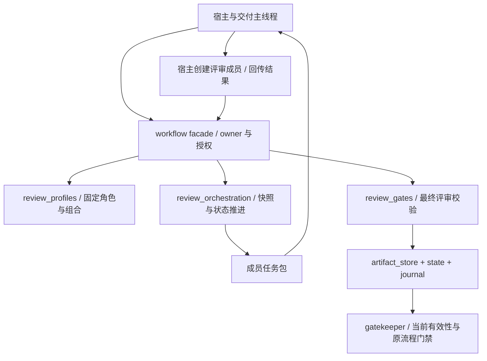

# V1.1.0 评审专家团编排 - 03 技术方案

| 字段 | 值 |
| --- | --- |
| 版本 | V1.1.0 |
| 作者 | Codex / Open Spec Lead（合并方案阶段分析） |
| 日期 | 2026-09-26 |
| 状态 | CR-003 角色契约方案已同步；实现增量实施中，完整 panel 仍为目标架构 |
| 源基线 | V1.0.42 |

## 修订记录

| 修订号 | 日期 | 作者 | 变更摘要 | 关联 CR |
| --- | --- | --- | --- | --- |
| REV-20260701-01 | 2026-07-01 | Codex | 历史 V1.1 评审编排方案。 | CR-001 |
| REV-20260926-01 | 2026-09-26 | Codex / Open Spec Lead | 按 CR-002 合并方案阶段分析并落盘当前 1.0.42 存储、owner、panel run、恢复和回滚架构。 | CR-002 |
| REV-20260926-02 | 2026-09-26 | Codex / Open Spec Implementation | 补充 22 字段角色卡、逐角色任务书、任务绑定、最小输入、证据分类和 CR-003 实施增量；完整 panel run/四 API 保持目标架构。 | CR-003 |
| REV-20260926-03 | 2026-09-26 | Codex / Open Spec Implementation | 固定两个复合 reviewer 席位，保留八个逻辑角色并同步席位身份、存储、测试和兼容规则。 | CR-004 |

## 变更关联与架构边界

- 变更请求：`CR-003`；继承 `CR-002` 目标架构
- 规范：`02-specification.md`
- 当前 runtime：`PLUGIN_VERSION=1.0.42`、`CANONICAL_SCHEMA_VERSION=v0.11`
- CR-003 当前实现增量：`review_profiles.py` 的 RoleCard、task builder、result validator，以及 `review_gates.py`/现有 review 路径的可选角色结果投影；完整 panel 仍需后续 `review_orchestration.py`、workflow facade、存储/恢复和 gatekeeper 策略实施
- 不影响：Host Goal 创建/恢复/完成协议、用户确认语义、implementation launch authorization、TASK 实现、closure validator、OpenCode 路线

V1.1 只将评审过程工程化。它不把专家团变成产品/架构/代码生产团队，也不实现 provider-specific spawn、模型路由、OS 沙箱、Dashboard、数据库或后台 daemon。

## 当前基线事实

- `ProductDeliveryWorkflow.record_multi_agent_review()` 是当前评审接纳入口。
- `review_gates.validate_multi_agent_review()` 是结构和 gate-specific 内容校验权威。
- `gatekeeper.review_input_hash()` 计算当前业务输入有效性；V1.1 需把 panel profile、角色、template 和 snapshot 绑定到新运行输入。
- `artifact_store.write_artifact()` 按 canonical delivery artifact → manifest → `current.json` → compatibility mirror 写入；根目录 mirror 不是 authority。
- state 和关键迁移使用 `write_state()`、`state_write_lock()` 与 hash-linked `transition_journal`。
- Host Goal owner、`CODEX_THREAD_ID`、fresh checkpoint 和 post-handoff stage transition 仍由 `host_goal.py` 控制；panel worker 不能 activate、reconcile、complete 或 stop Goal。
- 当前插件生成物来自 `src/product_delivery_agent`；V1.1 设计不能直接手改 packaged runtime 副本。

当前工作树已有 `review_profiles.py` 的八个角色、五个 profile、任务构建和结果校验增量；这些纯定义/校验函数不等于完整运行时编排。`review_orchestration.py`、PanelRun 生命周期、全员屏障、恢复/receipt 和下述四 API 仍是目标架构，未在 CR-003 中声明完成。准确角色/profile 以 [01](01-requirements.md)、[02](02-specification.md) 和 [09](09-role-cards.md) 为准；存储提交协议 [04](04-storage-design.md) 保留为后续架构。

## 模块职责

### `review_profiles.py`（CR-003 实现增量）

纯定义模块，不写 state、artifact 或 Host Goal。提供：

- 八个正式 22 字段 `RoleCard`；版本字段统一为 `role_version`，完成标准、升级条件和 peer 契约使用正确的语义与类型；
- 五个 `PanelProfile`；
- 每角色 required/optional inputs、task steps、must-check/must-not-do、evidence/completion/escalation 和 output schema；
- role/profile/catalog 规范化 JSON 与 hash；catalog 仅追溯来源，有效性只比较本次冻结且使用的角色/profile/template；
- 缺字段、未知 ID、重复 role、gate 错配的校验；
- task builder 绑定 delivery、project_type、review type、输入快照、角色/role_version/hash/template 和 task hash，只投递角色允许的最小输入；
- result validator 核对任务绑定、逐项必查与证据、finding/risk/question/blocker 分类和成员只读边界；可选 role result 投影继续进入现有 review validator。

角色 ID 固定为：`product.intent_reviewer`、`scenario.journey_reviewer`、`negative.boundary_reviewer`、`test.strategy_reviewer`、`coverage.traceability_reviewer`、`coverage.assertion_reviewer`、`test.implementation_reviewer`、`ui.conformance_reviewer`。

### `review_orchestration.py`（后续目标架构）

纯策略、reducer 和校验模块，不直接 provider-spawn、不持有权威 state。facade 读取文件并验证来源后，传入事实供纯函数计算；模块不自行写入工件。提供：

- input snapshot builder；
- seat task/role brief planner；
- event schema、phase barrier、revision/CAS 检查；
- member result、challenge、revision、adjudication 聚合；
- stale/blocked/needs_remediation 分类；
- legacy review projection payload；
- pending intent 校验和恢复计划。

### `workflow.py` facade

提供四个公共 workflow API，负责当前 delivery 授权、coordinator/Host Goal 边界、canonical artifact/state 写入和 transition journal。内部只调用 orchestration 纯函数，不让成员绕过 owner。

### 现有权威模块

- `review_gates.py`：继续校验最终 projection，不能被 panel reducer 替代。
- `gatekeeper.py`：继续计算当前 input hash、stale 和 blockers。
- `artifact_store.py`：继续处理 delivery layout、manifest、current pointer、mirror 和 artifact identity。
- `transition_journal.py`：记录 panel prepared/event/finalized/stale/blocked 等关键迁移。
- `host_goal.py`：继续要求 handoff 后每个公开 mutation（包括事件批次与恢复）使用 fresh checkpoint；一次 API 的内部 reducer、提交和投影只消费一次。

## 完整 panel 核心流程（目标架构）

1. `prepare_review_panel()` 校验当前 delivery、runtime provenance、multi-agent policy、项目分支、gate profile 和 required inputs。
2. 从 canonical delivery artifact 和必要的仓库文档/测试源码构建不可变 `ReviewSnapshot`，所有来源固定路径、内容哈希与必要副本。计算所用 profile/role/template/policy hash，创建 2–3 个 seat tasks。
3. 正常模式由宿主按 brief 创建真实成员，记录 `identity_kind=spawned`，ID 互异且非 coordinator。既有授权的 `role_simulation` 则记录 `identity_kind=simulated` 和逻辑席位，真实 ID/source 为空，不伪造调用；运行绑定 review_mode、policy hash 和降级接受引用。V1.1 不定义 provider spawn API。
4. `record_review_panel_events()` 依次接收独立结果、质疑、修订、恢复事件；每个阶段全员屏障后才能推进。
5. owner 冻结去重 finding-set，记录裁决和未解决问题。
6. `finalize_review_panel()` 检查角色契约、输入快照、屏障、usage、blocking findings 和 gate-specific projection。
7. 先验证完成候选再提交 run 与正式投影，复用现有 `record_multi_agent_review()` 的校验/登记内部路径，不重复消费外层 checkpoint。`phase=completed,status=passed` 才能写正式通过摘要；不能先放行再补 receipt。
8. 有问题时返回 `needs_remediation`；修复由原 workflow 完成，修复后新 snapshot/new `parent_run_id` 复验。

## 公共接口设计（目标架构，CR-003 未实现）

### `prepare_review_panel(review_type, parent_run_id=None)`

返回 `run_id`、`profile`、snapshot refs/hash、seat tasks、phase=`prepared`、revision 和 deadline。它只准备任务，不产生通过结果。

### `inspect_review_panel(run_id)`

严格只读，返回 phase、status、revision、seat summaries、缺失席位、deadline、snapshot/hash、pending recovery 和下一动作。它不修复 pending、不消费 checkpoint、不推进 phase。

### `record_review_panel_events(run_id, events, expected_revision)`

校验 owner、run、seat、phase、attempt、role/hash、snapshot/hash、schema、usage 和 revision；按 `(event_id,payload_hash)` 幂等；迟到或冲突事件拒绝。

### `finalize_review_panel(run_id)`

要求 independent → challenge → revision → adjudication 屏障完整；调用既有 validator，成功后才投影 legacy review。`blocked`、`stale`、`needs_remediation` 不得投影成 passed。

## 阶段、超时与恢复

- 阶段：`prepared → independent_review → cross_challenge → revision → adjudication → validating → completed`。
- 异常：`blocked`、`stale`、`needs_remediation`。
- 从宿主开始执行对应阶段计时，每席位每阶段默认 600 秒；排队不计时，并发不足可串行创建独立实例但不能少角色。每席位每 run 最多一次同席 retry 或替换，二选一。
- 同快照替换席位时从最早受影响阶段重新收集；旧 challenge/revision/adjudication 不复用。输入漂移使原 run stale，创建新快照及新 run，不覆盖旧快照。
- 一次自动周期最多初审加一次复验；相同失败 snapshot + finding-set 不得重开。有新修复证据后，主流程可记录原因并启动新有界周期。
- 超限只返回 `needs_remediation`、根因和 finding-set identity，不修改整个 delivery/Host Goal 状态。

## 关键 ADR

| ADR | 决策 | 备选 | 理由 |
| --- | --- | --- | --- |
| ADR-001 | 角色/ profile 与 run/artifact 分离 | 将所有配置塞入 review Markdown | 可版本化、复用并单独校验 |
| ADR-002 | workflow facade 保持 owner；orchestration 为纯策略 | panel worker 直接写 state | 保持 canonical writer、Host Goal 和 closure 权威 |
| ADR-003 | 继续 file-backed delivery store，不上 DB/daemon | 外部队列或数据库 | 与当前 artifact_store、manifest、journal 和部署边界一致 |
| ADR-004 | 不可变共享快照 + 全员屏障 + 一次质疑/修订 | 自由多轮群聊 | 控制成本、避免早期锚定和无限循环 |
| ADR-005 | provider spawn、模型和可选隔离由宿主管理 | Product Delivery 自己路由模型 | 当前规则明确模型管理转移给 Codex host |
| ADR-006 | 单层事务锁、revision/CAS 和可重放 pending intent | 多次独立 state 写入 | 避免嵌套锁、CAS window 和中断后伪通过 |
| ADR-007 | legacy 记录只读兼容，新 delivery 才启用新契约 | 删除或重写旧 state | 保持历史证据，避免混写 active delivery |
| ADR-008 | V1.2 才增加生产专家 | 在 V1.1 中让 reviewer 修改产品/代码 | 保持评审线和生产线边界清晰 |

## 中断、提交与 Host Goal

当前 `write_state()` 自持锁，panel mutation 不得外层持锁后再次调用公共 `write_state()`。实现时须使用单层事务边界和内部 locked helper，覆盖 revision 读取、owner 校验、意图形成、artifact 写入、state commit 的协调过程。

现有 `write_artifact()` 的 canonical、manifest、pointer、mirror 是多步操作，V1.1 不宣称跨文件原子。提交先保存可重放 intent artifact（有限 payload 或 durable refs、目标 artifact hash、event IDs、expected revision），state 的 `pending_commit` 只保存 intent ref/hash。崩溃后由原 mutation API 校验当前 owner、runtime、业务输入、run revision 和 artifact identity，再按 event hash 幂等重放；`inspect` 不自行修复。pending intent 不能单独产生 passed。

handoff 后的 panel mutation 重新走 fresh Host Goal reconciliation checkpoint，不回滚整份 state、不重放旧 Goal checkpoint、不允许 panel worker 完成或接管 Goal。

## 可观测性、风险与回滚

每次 run 记录 run/profile/gate/delivery ID、snapshot/role/template hashes、seat phase/status/latency/retry、stale/blocked/replacement reason、artifact/transition refs、finding counts、实际 protection level 和 usage（或 `unavailable`）。保存复现任务所需的冻结模板、brief 和证据引用，不另存模型名、密钥或无关完整会话；哈希不证明结论正确或成员身份具有密码学真实性。

回滚时停止新的 panel dispatch，保留 JSON/Markdown/run receipt 为 supporting evidence；旧 active delivery 不混用 runtime，blocked/stale 不改成 passed，closure authority 不变。实现阶段必须补并发 mutation、崩溃恢复、pending replay、hash stale、替换重收集和 legacy compatibility 测试。

| 风险 | 缓解与后续验证 |
| --- | --- |
| 成员意见相关、产生误报 | 最小上下文和不同检查方法；按 01 的相同材料/相近预算评估，不提前宣称质量提升 |
| 部分结果或旧 schema 绕过专家团 | facade 与 gatekeeper 双重要求有效 run projection；成员数、角色和屏障缺一不可 |
| 共享文件系统被修改 | owner API 边界、brief 只读纪律、输入哈希复核；记录真实隔离能力，不承诺 OS 沙箱 |
| 多文件中断与并发覆盖 | 04 的 intent、单层锁、修订号与重复事件处理；逐写入步骤故障注入验证 |
| 升级导致旧交付停摆 | 原 active 用原 runtime 完成后再升级；新 policy 绑定 activation，不能缺字段就走 legacy |
| reviewer 变更触发无谓重新确认 | 评审输入哈希与用户产品/测试语义分离；仅语义变化沿用原确认门禁 |

## FR/NFR 追溯

- FR-001、FR-018、FR-019 → `review_profiles.py`、Panel Profile 校验。
- FR-002、FR-020、FR-021、NFR-005、NFR-007、NFR-008、NFR-012 → snapshot、role brief、hash/stale。
- FR-003～006、FR-014～017、NFR-001～006 → workflow facade、review_gates、projection、兼容。
- FR-007～011、FR-023、NFR-010～011 → phase barrier、timeout、retry/replace、bounded cycle。
- FR-022、FR-024、NFR-009、NFR-013 → owner writer、permission boundary、receipt/usage。
- FR-012、FR-013 → 历史 gate 效力、新 policy、UI/non-UI 来源与旧 runtime 边界（ADR-007）。

## 信息缺口

| 等级 | 项目 | 处理 |
| --- | --- | --- |
| Blocker | 无 | 当前规范已冻结模块边界、宿主边界、存储真源和回滚策略。 |
| Assumption | 宿主提供真实成员调用和事件回传；可选隔离由宿主决定。 | 实现时记录 protection level；不提供 provider adapter 或 OS sandbox。 |
| Assumption | 当前插件生成物继续由 `src` 生成。 | 源码实现后再 package，不能直接手改 packaged runtime。 |
| Nice-to-know | 精确并发数、用量字段实际可得性、跨 gate 角色统计。 | 实施/复盘阶段测量。 |

## 方案阶段门禁

**PASS（CR-002 / REV-20260926-01）**：方案明确模块、边界、公共 facade、生命周期、owner 权威、当前 1.0.42 存储链、Host Goal 约束、恢复、回滚和 V1.2 边界；无 Blocker。本文件是设计方案，不代表代码已实现。

## CR-003 任务与结果校验实现路线（REV-20260926-02）

1. 使用命名字段构建 RoleCard，校验 22 字段类型和语义；`completion_criteria` 只描述完成条件，`escalation_conditions` 只描述升级条件，`peer_challenge_contract` 必须是包含质疑对象、回应义务和不可裁决边界的对象。卡片可带五例/质量 rubric，但不得用扩展字段补偿缺失的正式字段。
2. task builder 按 gate profile 取得冻结卡片；验证 delivery/project_type/input_snapshot 和输入类型/引用，投影最小输入，计算角色定义、模板与整个任务的稳定 hash。即使上游 context 包含 peer 或预设结论也不注入首轮。
3. result validator 接收对应任务的期望绑定，逐项比对身份、hash、check/evidence 和权限；发现 ID 唯一且 blocker 引用可解析，`passed` 不能包藏未解 blocker 或关键未解问题。无发现必须有逐项正向检查证据。
4. 如果调用方提供 role results，现有 review 投影按五种固定 profile 检查角色完整/唯一；在 owner 路径复用原有 `validate_multi_agent_review`，不新增成员 canonical writer，不把可选投影升级成完整 panel claim。
5. 定向测试先覆盖缺字段、参数错位、额外/泄漏输入、串任务结果、空/伪证据、悬空 blocker、重复身份和旧 review 兼容，再执行受影响回归。代码事实与测试结果由 05/06 记录，不把正在修复的缺陷写成规范。

| 当前增量 | 追溯 | 仍需后续完成的架构 |
| --- | --- | --- |
| RoleCard + 文本任务书 | FR-018、NFR-007 | catalog 冻结持久化和完整 panel receipt |
| task builder + 任务绑定 | FR-002、FR-019～021、NFR-005、NFR-008～010 | canonical snapshot 重算和四 API 派发 |
| result validator + 可选投影 | FR-008、FR-012、FR-017、FR-019～022 | 事件屏障、裁决 reducer、事务提交、stale/恢复 |
| runtime_policy 声明 | FR-023 | 宿主计时、终止、重试/替换和复验执行 |

**PASS（文档）**：CR-003 模块边界、校验路线和后续架构边界明确。完整 V1.1 功能、发布或闭包不因本次文档通过而完成。

## CR-004 复合席位技术增量

`review_profiles.py` 保留 RoleCard 目录，新增 `SEAT_PROFILES`、`get_gate_seat_profile()` 和 `build_gate_tasks()`。workflow 只读准备接口使用席位 profile，review gate 校验席位与逻辑角色映射；gatekeeper 将席位映射和席位 hash 纳入 stale binding。

席位是 dispatch/identity 单位，逻辑角色是 evidence/result 单位。这样把实际调用从每 gate 三个逻辑角色压缩为两个 Agent，同时保留每项职责的独立检查记录。
